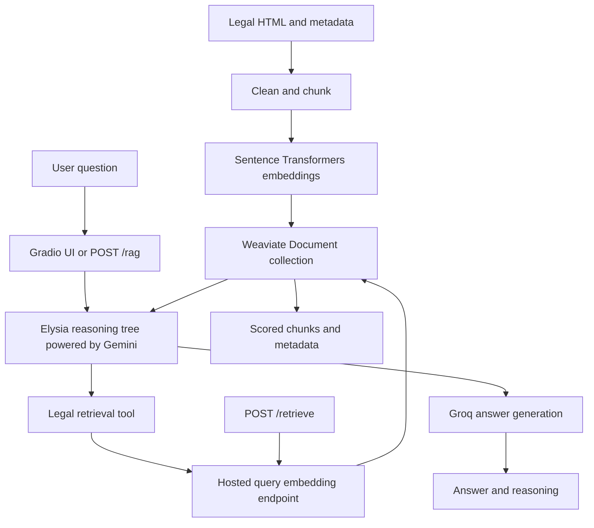

# Vietnamese Legal RAG

**A Vietnamese legal question-answering application with agent-guided retrieval, hybrid search, and a web chat interface.**

The application combines an Elysia reasoning tree, hosted text embeddings, Weaviate hybrid search, and Groq answer generation. It includes a FastAPI backend, a Gradio chat UI, document preparation/indexing scripts, and Prometheus metrics.

**Stack:** Python 3.11 · FastAPI · Gradio · Weaviate · Elysia · Gemini · Groq.

## Features

- **Legal document ingestion:** Crawl HTML and metadata, extract legal text, and split Vietnamese chapters, articles, and clauses.
- **Embedding and indexing:** Build local embeddings with Sentence Transformers and index document chunks in Weaviate.
- **Hybrid retrieval:** Combine vector similarity with lexical search and return scored chunks from `/retrieve`.
- **Agent-guided RAG:** An Elysia tree uses a legal retrieval tool to gather relevant provisions; Groq generates the final answer from the retrieved reasoning output.
- **Chat UI and API:** Gradio at `/`, OpenAPI documentation at `/docs`, and separate retrieval/RAG routes.
- **Operations:** Health checks, request metrics at `/metrics`, runtime logs, and a Dockerfile.

## Architecture



The RAG path uses `app/config/tree_config.py`; `/retrieve` exposes a separate retrieval service. The current RAG response contains `answer` and `reasoning`, rather than a separately validated list of citations.

## Quick start

Use Python **3.11**, matching the Dockerfile and CI environment.

```bash
git clone https://github.com/caubetotbunggg/vietnamese-legal-rag-pipeline.git
cd vietnamese-legal-rag-pipeline
python -m venv .venv
source .venv/bin/activate
python -m pip install -r app/requirements.txt
cp .env.example .env
```

On Windows, activate with `.venv\Scripts\activate` and copy the template with `Copy-Item .env.example .env` in PowerShell.

Configure `.env` with your own credentials before starting the application:

| Variable | Purpose |
| --- | --- |
| `WEAVIATE_URL` | Weaviate Cloud cluster URL |
| `WEAVIATE_API_KEY` | Cluster credential; the indexed collection is named `Document` |
| `GEMINI_API_KEY` | Elysia base/complex reasoning models |
| `GROQ_API_KEY` | Groq client used by the health service |
| `GROQ_API_KEY_B` | Groq client used for final answer generation |
| `API_URL` | Optional UI backend URL; defaults to `http://localhost:8000/rag` |
| `EMBEDDING_MODEL` | Local Sentence Transformers model used by the offline embedding scripts |

The service currently connects to Weaviate Cloud while importing its settings. It requires a reachable cluster and the model credentials; starting the HTTP server alone does not build or populate the index.

Query embeddings currently come from the Gradio endpoint `caubetotbunggg/api_2`, using `/embed_text`. Local document embeddings must use the same embedding model and vector dimensions as this query endpoint. That external endpoint's availability and model configuration are not managed by this repository.

Reasoning and answer model defaults are in `app/config/settings.py`. Check provider availability and update them for your account before a live deployment.

```bash
python -m uvicorn app.main:app --host 0.0.0.0 --port 8000
```

Open `http://localhost:8000/` for chat or `http://localhost:8000/docs` for the API. The UI displays conversation history; the current backend processes each question independently.

## API examples

Both POST endpoints accept **query parameters**, not JSON request bodies.

```bash
# Retrieve scored document chunks
curl -X POST -G http://localhost:8000/retrieve \
  --data-urlencode 'user_input=Quyền và nghĩa vụ của người lao động là gì?' \
  --data-urlencode 'k=5'

# Generate a Vietnamese legal answer
curl -X POST -G http://localhost:8000/rag \
  --data-urlencode 'user_input=Thủ tục ly hôn đơn phương như thế nào?'
```

Illustrative response shape for `/rag`:

```json
{
  "answer": "Câu trả lời dựa trên nội dung được truy xuất...",
  "reasoning": "Các điều luật được reasoning tree tổng hợp..."
}
```

| Method | Endpoint | Result |
| --- | --- | --- |
| GET | `/` | Gradio chat UI |
| POST | `/retrieve` | `chunks` containing text, score, chunk ID, and metadata |
| POST | `/rag` | `answer` and optional `reasoning` |
| GET | `/health` | Dependency checks for Weaviate, Groq, and the local UI |
| GET | `/metrics` | Prometheus HTTP metrics |

`k` controls `/retrieve`. Although `/rag` accepts `k`, its current Elysia tool has a fixed retrieval limit of 5. Retrieval chunk IDs are response-local indices. Metadata can be a stored title string or a structured object. There is no current `/agent` or `/rag-query` route; some historical documents describe earlier versions.

## Prepare documents and build the index

Run scripts as modules from the repository root. Install the additional offline data dependencies only if you need to rebuild the corpus:

```bash
python -m pip install -r requirements-data.txt
python -m scripts.run_crawl all
python -m scripts.cleaner
python -m scripts.chunker
python -m scripts.assemble_dataset
python -m scripts.make_manifest
```

The crawler targets the markup documented in [site structure](docs/site_structure.md). Source HTML and access behavior can change. Assembly joins each chunk with its document metadata as `{"meta": {...}, "chunk": {...}}`.

After choosing an embedding model compatible with query-time embeddings and configuring Weaviate credentials:

```bash
python -m scripts.build_embeddings
python -m scripts.index_embeddings
```

Indexing writes to the `Document` collection. Review the destination and schema before rebuilding an existing collection. `scripts/init_index.py` is a separate local-Weaviate helper; the runtime API and indexing script use Weaviate Cloud.

`data/` is intentionally ignored and is not shipped in the application branch. The older coursework snapshot is still available in [Git history](https://github.com/caubetotbunggg/vietnamese-legal-rag-pipeline/tree/3c0468196d774e9a9db55e9b0151f9be0b58a3a8/data). Its 51,931 records describe that historical snapshot, not the current deployed index or an evaluation result.

## Tests

```bash
python -m pip install -r requirements-dev.txt
python -m pytest tests -q
```

The automated suite replaces Weaviate and reasoning-tree setup with test doubles and mocks external model calls. It checks service/API behavior without production credentials. It does not measure legal answer quality or verify a live deployment. CI runs these tests on Python 3.11.

## Docker

```bash
docker build -f app/Dockerfile -t vietnamese-legal-rag .
docker run --rm --env-file .env -p 8000:8000 vietnamese-legal-rag
```

The container requires the same external services and a populated index as local execution. The monitoring Compose file is under `monitoring/`; its targets may need adjustment for your environment.

## Repository layout

```text
app/
  main.py                 # FastAPI lifecycle and Gradio chat interface
  config/                 # credentials, paths, and Elysia tree/tool setup
  controllers/            # retrieval, RAG, and health HTTP endpoints
  services/               # hybrid retrieval, answer generation, health checks
  models/                 # Pydantic response/request models
  prompts/                # retrieval reasoning and answer prompt templates
scripts/                  # crawling, cleaning, chunking, embeddings, indexing
tests/                    # isolated service/API tests
monitoring/               # Prometheus and Grafana configuration
postman/                  # historical API collections
docs/                     # design notes and historical test reports
```

## Development history

The original default branch contained the early data pipeline. The complete application was developed on `dev-test-deploy`, then extended on `dev` with UI, prompt, and test updates. `main` now integrates `dev`, which includes the full deployment branch history. Older weekly, backup, and experimental precision branches remain available for reference.

## Current limitations

- External embedding/model services and Weaviate credentials are needed for live execution. Defaults and model availability should be checked before deployment.
- The reasoning tree uses shared process-level state; concurrent-request isolation needs evaluation.
- `/rag` does not yet honor its requested retrieval limit or return structured source IDs/URLs. Citations in generated prose are not independently validated.
- Chunk coverage, legal document versions/effective dates, and end-to-end retrieval quality need a reproducible evaluation set.
- Historical manual/load-test reports describe older endpoints and do not establish current performance. No fresh quality or latency benchmark is claimed here.

The corpus originates from [LuatVietnam](https://luatvietnam.vn/). This is an educational legal QA project; verify source permissions and the current legal status of retrieved documents before reuse. This repository currently has no license file granting general reuse rights.
