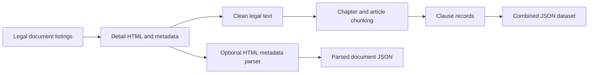

# Vietnamese Legal RAG Pipeline

**A data preparation pipeline for Vietnamese legal retrieval-augmented generation.**

Collect legal documents, extract their text and metadata, and split them into chapter, article, and clause records for downstream search and question answering. The implementation uses Python, Requests, Beautiful Soup, and regular expressions to preserve legal structure during preprocessing.

> **Project scope:** This repository implements the ingestion and preprocessing layer of a legal RAG application. Embedding generation, a vector index, retrieval, LLM answer generation, and a chatbot interface are future work; they are not included in the current code.

## Highlights

- Concurrent list and detail crawlers with request timeouts, per-worker delays, and failure logs.
- Extraction of document identifiers, titles, dates, document types, and legal fields where available.
- HTML-to-text cleaning and structure-aware splitting into **Chương → Điều → Khoản**.
- Per-document chunk files, a combined JSON dataset, and an HTML/parsed-file manifest.
- Existing tests for chunking, cleaning, and assembled dataset structure.

## Pipeline



The chunking path reads cleaned text directly. The optional HTML parser produces a separate document-level JSON representation; its output is not the input to `chunker.py`.

## Included data

Counts below describe the checked-in snapshot, not a live crawl or a quality benchmark.

| Artifact | Count |
| --- | ---: |
| Saved HTML documents | 522 |
| Cleaned text files | 522 |
| Per-document chunk files | 522 |
| Non-empty per-document chunk files | 407 |
| Records in `all_chunks.json` | 51,931 |

There are **115 empty chunk files** in the snapshot. The regex parser can miss documents without recognized chapter headings and needs further evaluation. A chunk count alone does not establish document coverage, legal validity, or retrieval quality.

### Chunk format

Illustrative record with shortened content:

```json
{
  "chuong": "CHƯƠNG I",
  "tieu_de": "Điều 1. Quy định chung",
  "noi_dung": "1. Nội dung khoản thứ nhất...",
  "khoan": [
    {"khoan": "1.", "noi_dung": "Nội dung khoản thứ nhất..."}
  ]
}
```

`khoan` is `null` when no numbered clauses are detected. The current combined dataset retains these four content fields; document IDs, source URLs, dates, and other document metadata are **not joined into the chunks**. Per-document filenames preserve the source document identifier before assembly.

## Quick start

Use Python 3.11 or newer. Run commands from the repository root.

```bash
git clone https://github.com/caubetotbunggg/vietnamese-legal-rag-pipeline.git
cd vietnamese-legal-rag-pipeline
python -m venv .venv
source .venv/bin/activate
python -m pip install "requests>=2.32.3" "beautifulsoup4>=4.13.4"
```

On Windows, activate the environment with `.venv\Scripts\activate`. These two packages are sufficient for the data scripts; `environment.yml` also lists the original development tools. `pyproject.toml` currently configures formatting and linting rather than an installable Python package.

### Inspect the included dataset without crawling

```bash
python -c "import json; from pathlib import Path; p=Path('data/processed/all_chunks.json'); rows=json.loads(p.read_text(encoding='utf-8')); print(f'{len(rows):,} chunks'); print(rows[0]['tieu_de'])"
```

### Rebuild chunks from the included cleaned text

These commands overwrite generated chunk files and the combined dataset:

```bash
python chunker.py
python assemble_dataset.py
```

Rebuilding can produce a different snapshot because the current chunker has known parsing gaps. Files that produce no chunks are listed in `data/unstructured/failed_regex.json`; existing chunk files are not removed automatically.

### Collect and process source documents

The crawler targets the listing and document markup described in [site structure](docs/site_structure.md). Review the source site's access conditions before collecting data; its HTML and access behavior may change.

```bash
python run_crawl.py list    # collect document URLs
python run_crawl.py detail  # fetch HTML and metadata; skip draft URLs
python run_crawl.py parse   # optional document-level metadata/content JSON
python cleaner.py
python chunker.py
python assemble_dataset.py
python make_manifest.py
```

`python run_crawl.py all` runs only `list`, `detail`, and `parse`. Cleaning, chunking, and assembly remain separate steps. Paths are resolved relative to the repository, so the checkout directory does not need the original coursework name.

The list crawler currently uses 38 pages, batches of 15 pages, up to 10 workers, and a 1.5-second delay per worker. The detail crawler uses up to 5 workers with the same delay. These are source constants, not CLI options; a per-worker delay is not a global rate limiter.

## Repository layout

```text
.
├── run_crawl.py          # CLI for listing, fetching, and optional parsing
├── list_crawler.py       # collect and deduplicate document URLs
├── fetch_detail.py       # save HTML and document metadata
├── parse_html.py         # parse document structure from source markup
├── cleaner.py            # extract text from the legal document container
├── chunker.py            # split chapters, articles, and clauses
├── assemble_dataset.py   # combine per-document chunks
├── make_manifest.py      # compare saved HTML and parsed JSON
├── paths.py              # paths independent of checkout directory name
├── data/
│   ├── raw/              # URLs, HTML, metadata, and parsed document JSON
│   ├── processed/        # text, per-document chunks, and all_chunks.json
│   └── unstructured/     # documents requiring inspection
├── docs/                 # source markup notes and crawling strategy
└── tests/                # existing unittest suite
```

`cleaner_debug.py` is a manual fallback that extracts text from the entire HTML page. Its output may include navigation and other page content; inspect it before using it for retrieval.

## Validation and current limitations

```bash
python -m unittest discover -s tests -v
```

The existing suite is not fully passing: a chunking fixture demonstrates article references being split as new articles, and the cleaner fixtures omit the document container required by the implementation. These issues need behavior-level fixes and representative document fixtures.

Other limitations to address before building a legal QA demo:

- Preserve document provenance, stable chunk IDs, source URLs, and effective-date/version metadata through assembly.
- Add coverage for chapterless documents, in-text article references, and unexpected source markup.
- Validate metadata and content completeness instead of relying on file existence alone.
- Add embeddings, retrieval, source-cited generation, and a small reproducible evaluation set.

## Source and intended use

The data was collected from [LuatVietnam](https://luatvietnam.vn/) for a learning project. The saved snapshot is historical and is not maintained as an authoritative or current legal corpus. It is intended for engineering experiments; verify source status and applicable data permissions before reuse. This repository currently has no license file granting general reuse rights.
